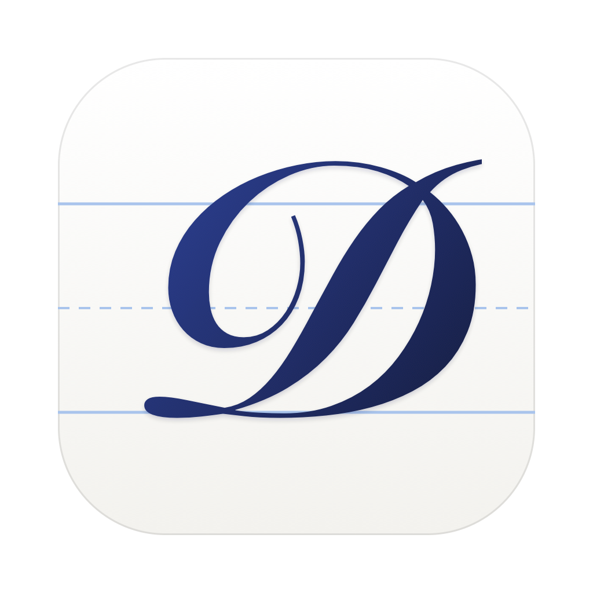
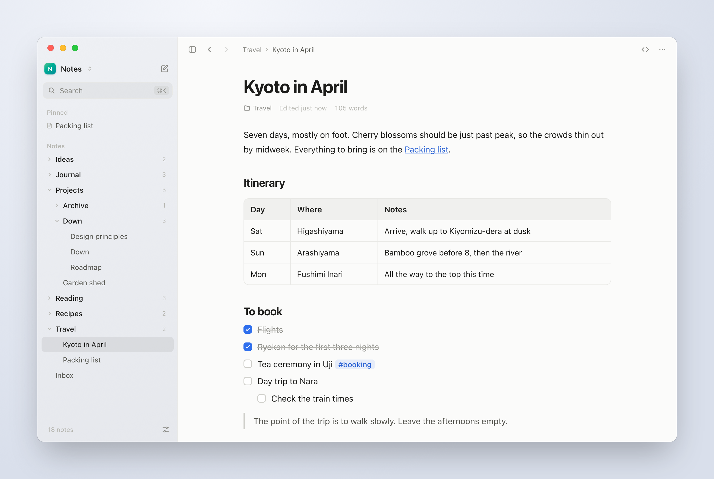
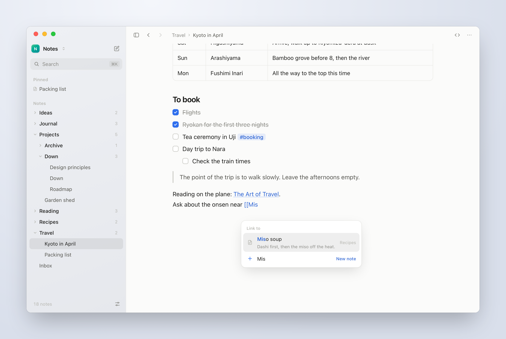
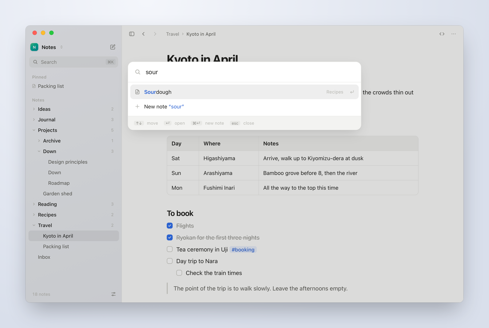
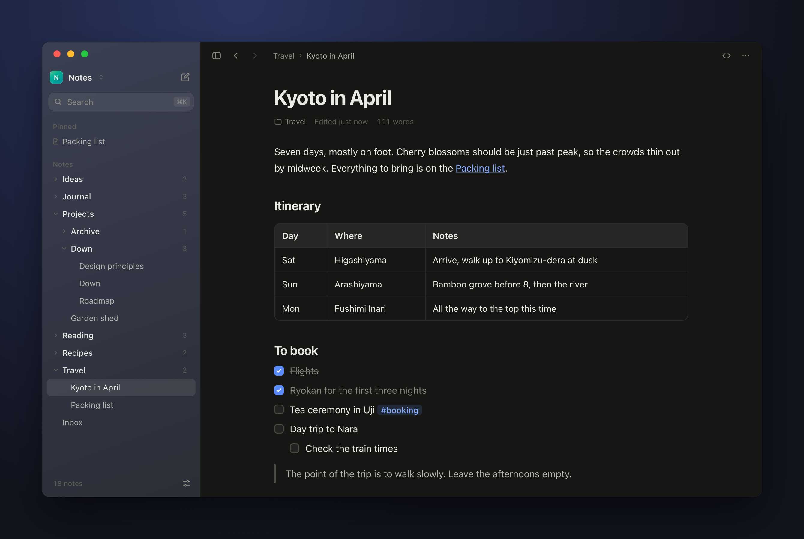

<p align="center">
  
</p>

<h1 align="center">Down</h1>

<p align="center">Write it down. A notes app for the Mac, built on a folder of plain markdown.</p>



Point Down at a folder, or at an Obsidian vault, and write. Every note is a `.md` file and every folder is a folder, so your notes open in any editor and sync with anything that syncs files.

## The sidebar

- Folders come first, then notes. Folders open in place, and a faint guide line shows what's inside what while you're in the sidebar
- Drag a note or folder onto a folder to file it there. Hovering a closed folder while you drag opens it. `⌘Z` undoes the move
- Right-click anything to rename it, pin it to the top, show it in Finder or move it to the Trash. Double-click a note to rename it in place
- Move to Trash uses the real Trash, and Undo puts the note back where it was
- The switcher at the top moves between vaults

## Writing



- The title is the file name. Change the title and the file is renamed
- `[[` links to another note, with suggestions as you type. `[[Note#Heading]]` jumps to a heading and `[[Note|text]]` shows other text
- A link to a note that doesn't exist yet is dashed. Click it and the note is made
- Rename or move a note and the `[[links]]` to it across the vault follow
- Notes that link to the one you're reading are listed at the bottom
- `/` opens a menu of blocks: headings, to-do lists, bullets, numbers, quotes, code, tables and dividers
- `#tags` show as small pills and stay plain text in the file
- Paste or drop an image and it's saved in the vault's `attachments` folder
- Front matter is kept exactly as it is, and the editor doesn't show it
- Plain text stays plain: `snake_case`, `5 * 3` and `C:\paths` are saved as typed, without extra backslashes
- An Untitled note you leave empty is cleared away when you move on

## Finding things



`⌘K` finds a note by its title first, then by what's written in it, with the match highlighted. With nothing typed it shows your recent notes. `⌘↵` makes a new note with what you typed.

## Changes from elsewhere

Down watches the vault. When another editor, git or a sync service changes a note, it shows up straight away. If you're typing in that note at the same time, both sets of edits are merged.

## Light and dark



Down follows the system appearance. Settings (`⌘,`) has the typeface (Sans, Serif or Mono) and the line width.

## Keys

| | |
|---|---|
| `⌘N` | new note |
| `⇧⌘N` | new folder |
| `⌘K` | find or create a note (`⌘O` and `⌘P` work too) |
| `⌘[` / `⌘]` | back / forward |
| `⌘/` | markdown source |
| `⌘\` | show or hide the sidebar |
| `⌘,` | settings |
| `[[` | link to a note |
| `/` | blocks |

## Run

```sh
pnpm install
pnpm app:build                  # builds src-tauri/target/release/bundle/macos/Down.app
pnpm app                        # the Mac app in dev mode, with hot reload
DOWN_VAULT=~/Notes pnpm dev     # the same UI in a browser at http://localhost:4322
```

Copy `Down.app` into `/Applications` to install it. Building needs Rust (`rustup`). In the browser, `server/api.ts` stands in for the Rust side, working on the folder in `DOWN_VAULT`.

The open vault and recent vaults are kept in `~/Library/Application Support/com.kelvinamoaba.down/prefs.json`. Open folders, pins and recent notes are kept by the app, so nothing extra is written into your vault.

Closing the window hides it, and the Dock icon brings it back. `⌘Q` saves any pending edit before it quits.

## License

MIT
